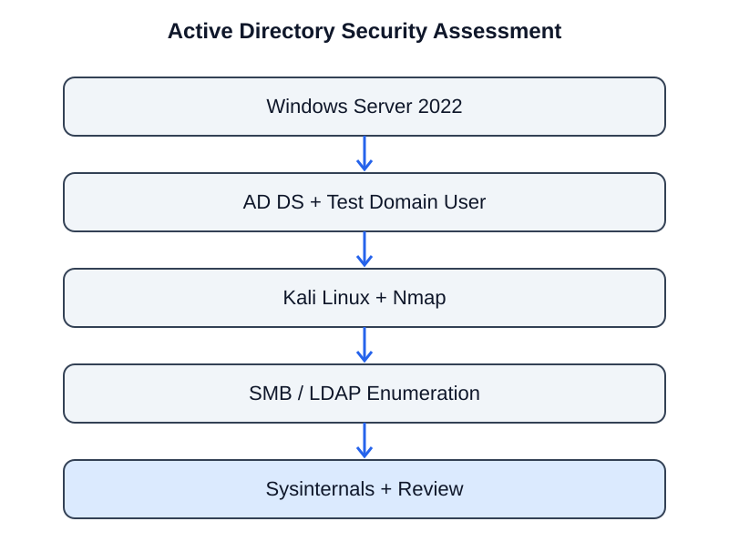

# Active Directory Security Assessment

> A hands-on Windows Server domain lab covering domain setup, network discovery, SMB and LDAP enumeration, and Windows system inspection.

[Supporting exercise: Network and User Discovery](docs/network-and-user-discovery.md)

## Project overview

This project documents the setup and security assessment of a small Active Directory lab. Windows Server 2022 was configured as a domain controller, while Kali Linux was used to inspect exposed services and enumerate domain-related information.

The work covered Active Directory Domain Services, test user creation, Nmap service discovery, SMB and LDAP enumeration, domain reporting, and inspection of Windows processes and logged-on users with Sysinternals utilities. The notes also describe controlled Metasploit exercises and a VirusTotal review of a test executable.

The goal was to understand how directory services operate, what information may be exposed during an assessment, and why identity, endpoint, and network monitoring are important.

## Lab environment

| System / tool | Purpose |
|---|---|
| Windows Server 2022 | Domain controller |
| Kali Linux | Security testing workstation |
| Oracle VirtualBox | Virtual lab platform |
| Active Directory Domain Services | Centralized domain and identity management |
| Nmap | Network and service discovery |
| Enum4linux | SMB-related enumeration |
| LDAPSearch | Directory queries |
| LDAPDomainDump | Directory information reporting |
| Metasploit Framework | Controlled security assessment exercises |
| Sysinternals AD Explorer | Active Directory object inspection |
| Sysinternals PsList | Process inspection |
| Sysinternals PsLoggedOn | Logged-on user inspection |
| VirusTotal | Test-file security analysis |

## Lab workflow

### 1. Prepare the virtual machines

Created Windows Server 2022 and Kali Linux virtual machines in VirtualBox and configured connectivity for the lab exercises.

### 2. Configure Active Directory

Installed the Active Directory Domain Services role through Server Manager and promoted the Windows Server machine to a domain controller. Created a test domain user through Active Directory Users and Computers.

### 3. Discover network services

Ran Nmap against the Windows Server lab system to identify open services. The notes record Active Directory-related services, including DNS, Kerberos, LDAP, and SMB.

### 4. Review SMB exposure

Used Nmap SMB enumeration capabilities and Enum4linux to inspect SMB-related information and reported shares. This exercise highlighted why organizations should restrict unnecessary share access and avoid exposing domain information to unauthenticated users.

### 5. Enumerate LDAP and domain information

Used LDAPSearch and Kerberos-related enumeration exercises to inspect domain information and user-account discovery behavior. LDAPDomainDump was then used to create readable reports of domain objects, including users, computers, and groups.

### 6. Inspect Active Directory and Windows activity

Used Sysinternals AD Explorer to inspect directory objects. Used PsList to review running processes and PsLoggedOn to inspect logged-on user information.

### 7. Conduct controlled security exercises

The source notes describe using Metasploit auxiliary modules for SMB and Kerberos enumeration and a controlled multi-handler/reverse-connection exercise in the isolated lab. These steps were used to understand the security implications of compromised access and the importance of endpoint monitoring.

### 8. Review a test executable

Submitted the lab test executable to VirusTotal and reviewed the returned detection information. A VirusTotal result is an indicator for investigation, not by itself proof that a file is malicious or benign.

## Security concepts explored

| Area | What the lab demonstrated | Defensive relevance |
|---|---|---|
| Domain identity | Domain controller and test user setup | Centralized identity governance and least privilege |
| Network exposure | DNS, Kerberos, LDAP, and SMB discovery | Reduce unnecessary exposure and monitor service access |
| SMB | Share and service enumeration | Restrict share permissions and review anonymous access |
| LDAP | Directory queries and object discovery | Protect directory data and audit queries |
| Domain reporting | User, group, and computer reports | Review stale accounts and excessive privileges |
| Endpoint visibility | Process and logged-on user inspection | Support host triage and incident investigation |
| File analysis | VirusTotal review of a test executable | Correlate multi-engine results with other evidence |

## Related Active Directory enumeration exercise

The companion [Network and User Discovery lab](docs/network-and-user-discovery.md) documents AD DS setup, test-user creation, Nmap discovery, SMB enumeration, DNS lookup, and PowerShell review.

## Practical skills

- Installing and promoting Active Directory Domain Services.
- Creating and managing test domain accounts.
- Discovering Windows domain services with Nmap.
- Inspecting SMB and LDAP exposure.
- Reviewing directory objects with LDAPDomainDump and AD Explorer.
- Inspecting processes and logged-on users with Sysinternals.
- Understanding the role of endpoint monitoring during controlled security testing.

## Evidence and limitations

The uploaded project reports document the AD DS setup, test-user creation, Nmap service discovery, SMB enumeration, LDAP/domain discovery, Sysinternals inspection, and Metasploit-based lab exercises. A companion network-and-user-discovery note is available above. Sanitized screenshots and command outputs should be added before claiming a full technical reproduction. No claim is made that this represents a complete enterprise Active Directory security audit.

To strengthen reproducibility, add redacted command output, screenshots of the lab configuration, sample sanitized LDAPDomainDump reports, and a short findings register. Remove domain credentials, hashes, private keys, user data, and live network details before publishing.

## Responsible use

All activities described here are intended for an isolated lab and authorized assessment only. Do not enumerate, exploit, or access a domain without explicit permission from its owner.

## Author

**Naga Venkata Eswara Sastry L**  
Cybersecurity learner | Aspiring SOC Analyst

